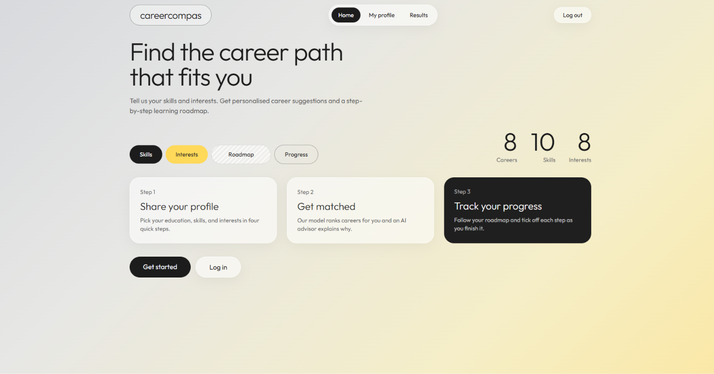
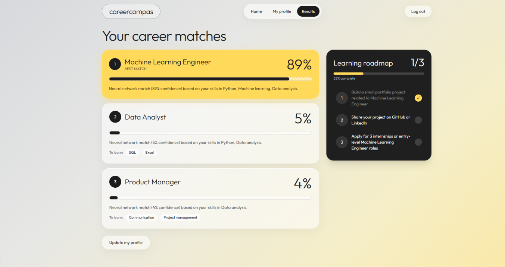

# CareerCompas

CareerCompas is a prototype AI career recommender built for interns. Users fill in a 4-step form with their education, skills, and interests, and the app suggests the top 3 matching careers with a match score. For each career, it explains why it fits and provides a learning roadmap. Progress is saved so users can tick off steps and come back later.

## Features
- 4-step form capturing education, skills, and interests
- Top 3 career matches ranked with a neural network confidence score
- "To learn" skill gaps listed under each match
- AI-generated explanations of why each career fits
- 3-step learning roadmap with a progress bar and tick-off steps
- JWT login, with saved progress per user
- Rule-based fallback when the model is unavailable

## Screenshots

### Home


### Career matches and learning roadmap


## Tech Stack
- **Model:** TensorFlow neural network with a rule-based fallback
- **Backend:** FastAPI + SQLAlchemy, JWT authentication
- **LLM explanations:** Gemini via the OpenAI SDK
- **Frontend:** Next.js + Tailwind CSS

## Getting Started

### 1. Clone the repo
```bash
git clone https://github.com/tabeeljohn2/CareerCompas.git
cd CareerCompas
```

### 2. Backend
```bash
cd backend
python -m venv venv
venv\Scripts\activate        # Windows
pip install -r requirements.txt
uvicorn main:app --reload
```

### 3. Frontend
```bash
cd frontend
npm install
npm run dev
```
Open http://localhost:3000.

### 4. Environment variables
Create a `.env` file (never commit it) with:
```
GEMINI_API_KEY=your_key_here
JWT_SECRET=your_secret_here
DATABASE_URL=sqlite:///./app.db
```

## Notes
This is a learning project that runs locally and is not a deployed product. The model is trained on synthetic data, so recommendations are for demonstration only and are not real career advice.